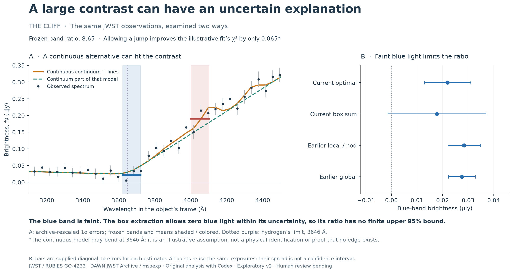

# Anatomy of a Little Red Dot

**Bounded exploratory extension · 18 September 2026 · Human understanding, science and release review pending**

**Question: When a spectrum looks like a cliff, how much of that appearance can we actually measure?**

A spectrum separates an object's light by wavelength. In three published little red dots observed by JWST, this project compares two narrow bands near hydrogen's Balmer limit. The original total-light ratios remain **8.65 for The Cliff, 3.05 for RUBIES-BLAGN-1 and 1.19 for RUBIES-UDS-182791**. Two clear contrasts and one weak result are supported under the stated error assumptions. The new work asks what those contrasts mean when the faint blue light is extracted differently and emission lines overlap the underlying continuum.

The most striking example also has the most fragile denominator. The Cliff's original blue-band flux is **0.02196 ± 0.00902 µJy** using supplied extraction errors. A profile-normalized box sum from the same saved observations gives **0.01776 ± 0.01919 µJy**. Its blue light is then smaller than its own formal error, even while the red band remains bright. The box ratio is 10.59 at the measured means, but it has **no finite positive upper 95% bound** under that diagonal-error model. A larger central ratio has not made the measurement more precise.

Read the left panel first. The dark points are actual measured light; the colored bands and horizontal segments show the original measurement. The orange curve illustrates a continuum that bends but stays continuous at 3646 Å, plus blended emission. Allowing that model a jump improves its weighted residual score by only 0.065. The spectrum therefore admits an explicit alternative to a sharp edge under these assumptions. The right panel shows how weak the blue-band measurement is under different reductions or weightings of the same exposures. These are correlated alternatives, not four independent observations.

This does **not** establish that the true spectrum lacks a Balmer discontinuity. The continuum shape, line groups, Gaussian resolution and independent-error treatment are assumptions. The model is useful because it demonstrates that an impressive finite-band contrast does not uniquely determine a sharp edge. It is not a physical explanation for what powers the object.

## What stayed stable, and what did not

| Object | Original total-light ratio | Archive-rescaled 95% interval | Native box-sum ratio | What the extension adds |
| --- | ---: | ---: | ---: | --- |
| The Cliff | 8.65 | 4.55–67.10 | 10.59; no finite positive upper 95% bound with box errors | Red excess remains; faint blue light limits its size. A continuous-at-limit model is a viable descriptive alternative. |
| RUBIES-BLAGN-1 | 3.05 | 2.35–4.17 | 3.04 | Ratio changes little across tested extractions. A continuous alternative also fits with archive-rescaled errors; smaller raw errors expose larger residuals. |
| RUBIES-UDS-182791 | 1.19 | 0.90–1.60 | 1.09 | Equal band brightness remains allowed. Joint line models leave substantial residuals, so their decomposition is not reliable. |

The intervals are conditional statistical results, not complete calibration or background uncertainty. The box values use that estimator's own formal errors; they do not inherit the original archive rescaling. No alternatives are averaged as independent evidence. The original stronger-correlation scenario already left The Cliff without a finite upper bound.

For The Cliff, earlier local/nod and global reductions give ratios **6.44 and 7.12** at the same frozen catalog redshift, compared with 8.65 in v4. They share the same three exposures. Both blue and red fluxes change, while profiles and calibration also change, so this cannot isolate a single background error. The saved BACKGROUND image can include source light from other nod positions; it is not a map of the remaining sky uncertainty.

Five fixed aperture/centering variants of each combined 2D cutout show only small changes within that set. This supports consistency under these particular choices, but all share the saved profile, photons and reduction. It cannot rule out a common bias. The source-specific line-spread function, covariance and individual nod behavior remain unmeasured here.

## The contribution and the stopping point

The contribution is a traceable observational reanalysis and an explanation of its limits: frozen band measurements, uncertainty propagation, extraction alternatives, a joint line/continuum counterexample, failures retained rather than tuned away, source/version checks, reproducible code and original figures. This selected trio cannot establish a population frequency, identify stars versus accretion as the power source, or reproduce the papers' complete physical analyses. No new objects or detector-level re-reduction were added.

Alison selected the project and directed its scope. The new code, checks, figures and draft interpretation were prepared with Codex. Observations belong to NASA/ESA/CSA JWST / RUBIES GO-4233 (PIs Anna de Graaff and Gabriel Brammer); reduced products are from the DAWN JWST Archive / msaexp. Alison's own understanding, interpretation, contribution wording and release approval remain pending.

Start the [owner walkthrough](research/owner-walkthrough-v2.md) with the central figure. The recommended next action is to discuss and review this bounded result, then decide whether the additional cost of exposure-level extraction work is justified by a specific remaining question. That would target systematics but would not improve PRISM's intrinsic spectral resolution. No such expansion is required to finish this version.

[Technical extension](research/observational-report-v2.md) · [Line diagnostic and residuals](research/amended-v2/line-results.md) · [Extraction methods and results](research/amended-v2/extraction-methods.md) · [Reproduce v2](analysis/AMENDED_V2.md) · [Website-ready copy](research/amended-v2/website-copy.md)

The [September 10 report](research/observational-report.md), protocol, numerical results and figures remain unchanged. The exact [prior case-study text](research/amended-v2/CASE_STUDY-v1-preserved.md) is preserved as an archival copy; its relative links retain their original locations. This v2 is explicitly exploratory, not a replacement preregistration or an agent-supplied science sign-off.
