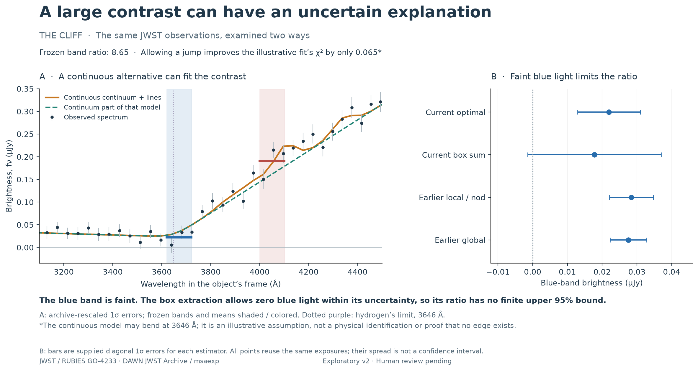

# Anatomy of a Little Red Dot

How much can three public JWST spectra tell us about an apparent jump in brightness?



The analysis compares the light on either side of the Balmer limit, then checks how faint blue light, extraction choices and overlapping emission affect the result. The ratios describe these three objects; they do not identify what powers little red dots.

[Read the case study](https://alisonthomasportfolio.com/projects/little-red-dot) · [Explore the code](https://github.com/alithomas321/anatomy-of-a-little-red-dot/tree/main/analysis) · [Methods](research/observational-report-v2.md)

## Run locally

The recorded environment uses Python 3.12.13.

```sh
python3.12 -m venv analysis/.venv
analysis/.venv/bin/python -m pip install -r analysis/requirements.lock
analysis/.venv/bin/python analysis/reacquire.py
analysis/.venv/bin/python analysis/measure.py
analysis/.venv/bin/python analysis/shapes.py
analysis/.venv/bin/python analysis/amended_v2_extraction.py
analysis/.venv/bin/python analysis/amended_v2_lines.py
```

The reacquisition step downloads missing public evidence and checks its original hashes. Saved measurements are in data/derived. [Data and sources](SOURCES.md) describe their origins.
